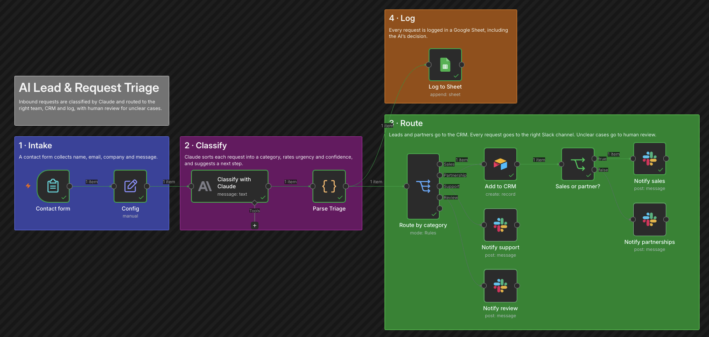
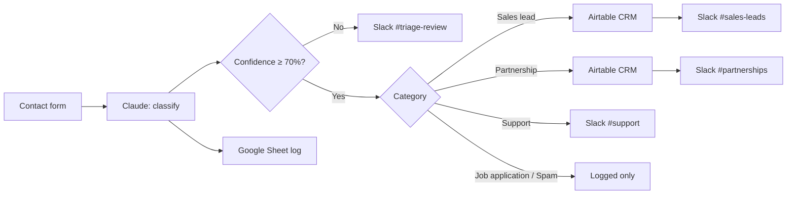
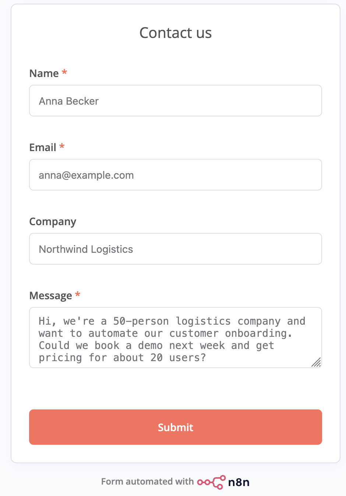
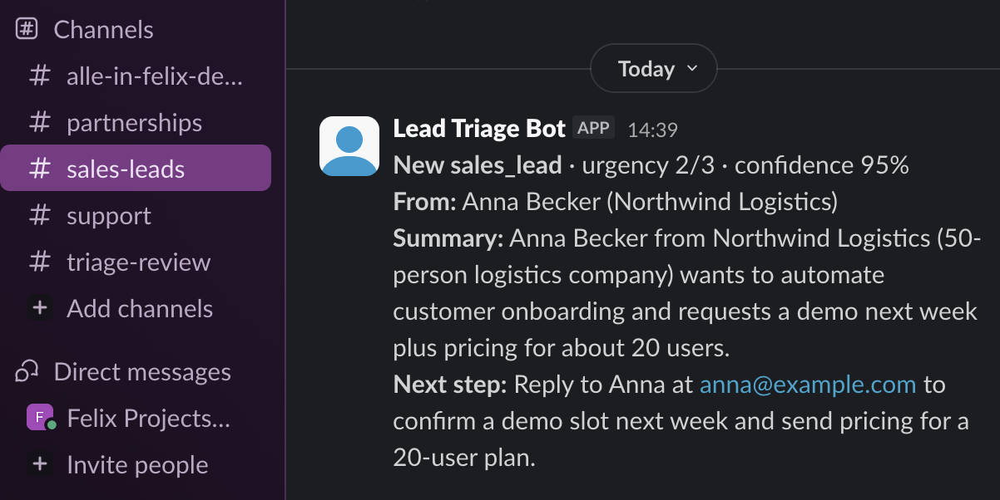
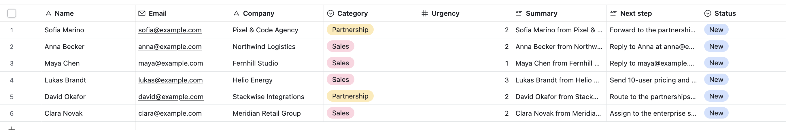
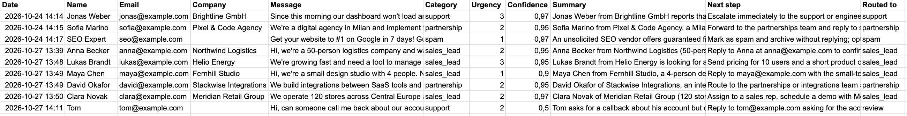
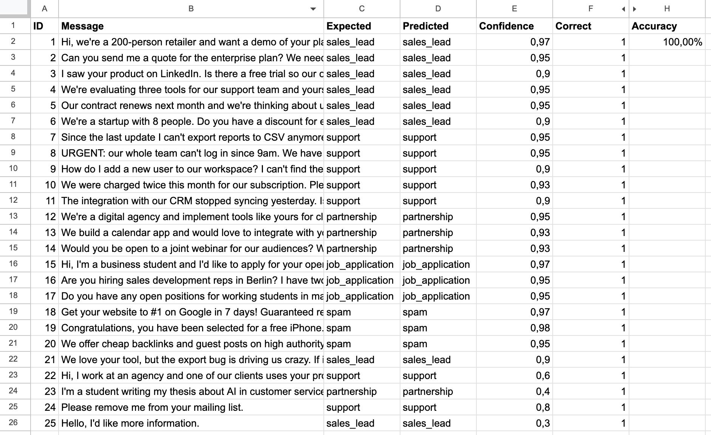

# AI Lead & Request Triage

An n8n workflow that reads every inbound request and lets Claude decide what it is and how urgent it is. It then routes the request to the right place: sales leads and partners into the CRM, every request into the right Slack channel, and unclear cases to a person.

*[n8n](https://n8n.io) is a visual automation tool: you connect apps like Slack, Google Sheets or AI models by drag and drop, and add code only where needed.*

Tested on 25 messages I wrote and labeled: accuracy rose from **96% to 100%** after one prompt improvement. **22 would have been routed fully automatically**, and the 3 most ambiguous would have gone to a person for review.



## The problem

Inbound requests usually land in one shared inbox: demo requests, bug reports, partnership offers, job applications and spam, all mixed together. Someone has to read each one, decide who should handle it and pass it on.

That costs time every day, and the expensive mistakes happen quietly: a sales lead waits hours for a reply, or an upgrade request gets buried in a support ticket.

## What it does

1. **Collects requests** through a contact form (name, email, company, message).
2. **Classifies each request with Claude** into one of five categories, with urgency (1–3), a confidence score, a one-sentence summary and a concrete next step.
3. **Routes it:**
   - Sales leads and partnerships → new record in the CRM (Airtable) and a message in `#sales-leads` or `#partnerships`
   - Support → `#support`
   - **Confidence below 70% → `#triage-review`** for a person to decide
   - Job applications and spam → logged only, nobody gets pinged
4. **Logs every request** in a Google Sheet with the AI's decision, as an audit trail.



## Results

| Contact form | Slack routing |
|---|---|
|  |  |

| CRM (Airtable) | Request log (Google Sheet) |
|---|---|
|  |  |

The urgency is read from context: a lead whose contract ends on Friday got urgency 3, a small studio with "no rush" got 1.

## Business case

An illustrative example, not measured data: if a team receives 50 requests a week and sorting each one by hand takes about 3 minutes, triage costs around **2.5 hours a week**. This workflow does it in seconds, and the summary and next step make the follow-up faster too.

The bigger value is speed on the requests that matter: sales leads reach the sales channel within a minute, already summarized, with the urgency flagged.

## Cost

Claude Haiku costs well under one cent per request. Slack, Airtable and Google Sheets run on their free plans.

## Measured quality

I built a separate test workflow that runs a labeled test set through the same Claude prompt and writes the predictions back to a Sheet.



- **Test set:** 25 messages. 20 clear cases across all five categories, plus 5 deliberately tricky ones with mixed intent.
- **Baseline: 96% (24 of 25).** The one miss was a customer reporting a bug while saying they'd upgrade to 25 seats once it's fixed. Claude called it support, so sales would never have seen the opportunity.
- **One prompt rule fixed it:** *"If a message mixes a problem with clear buying intent, classify it as sales_lead."*
- **After: 100% (25 of 25)**, with no other case changing.
- **Automatic vs. human:** Claude picked the right category every time, but only **22 of 25** would have been routed automatically. The three most ambiguous messages scored a confidence of 0.3–0.6, below the 70% threshold, so in the live workflow they would go to a person instead. Clear cases scored 0.90–0.98.

**How to read these numbers:** I wrote the test messages myself and tuned the prompt on the same set, so 100% shows the logic works on these cases, not that it will be perfect on new ones. Some labels are also debatable: is a student asking for a thesis interview a partnership? The next step is a separate set of new, real messages that the prompt has never seen.

Full results: [`tests/test-set-results.csv`](tests/test-set-results.csv).

## Security & privacy

| Tool | Access | What it means |
|---|---|---|
| Slack | `chat:write` only | The bot can post messages. It cannot read any conversations. |
| Airtable | Token limited to one base, records read/write | No access to any other base or to account settings |
| Google Sheets | `spreadsheets` | Spreadsheets only, nothing else in Google Drive |

Other choices:
- **Human review for low confidence**, so the AI never makes an unsure decision on its own.
- **A clean CRM:** only sales leads and partnerships become records. Support, applications and spam stay out.
- **Robust parsing:** if Claude's answer can't be read, the request goes to review with a clear note instead of failing silently.
- n8n runs locally and is only reachable from my own machine. Demo accounts were used for all tools.

### Data privacy

Contact requests contain personal data: names, email addresses and whatever people write. In this setup, that data is sent to an external AI provider and stored in Google Sheets, Airtable and Slack. All data in this project is made up.

In a real company, especially under GDPR, this would need:
- a data processing agreement with each provider, including the AI provider
- a note in the contact form and the privacy policy that requests are processed with AI
- a retention rule, e.g. deleting log entries after a set period
- access to the log and the CRM limited to the people who need it

## Limitations

- **Duplicates:** if the same person writes twice, the CRM gets a second record.
- **No spam protection on the form:** bots could submit it. The AI sorts them out as spam, but each one still costs an API call.
- **No retries:** if Slack or Airtable is down, that step fails. The request is still logged in the Sheet, so nothing is lost, but nobody is notified.
- **English only:** the prompt and tests are in English. Other languages are untested.
- **Small test set:** see "How to read these numbers" above.

## What I learned

- **Test with hard cases, not just easy ones.** 20 clear examples scored 100% straight away and proved little. The tricky, mixed-intent messages showed where the prompt needed work.
- **Low confidence is a feature.** Instead of forcing a decision, the workflow hands unclear cases to a person. That's what makes AI safe to use in a real process.
- **Plan for the AI failing.** Vague messages sometimes produced answers that couldn't be read. A fallback that routes them to review fixed that.
- **Integrations break quietly.** Renaming one field in Airtable stopped the CRM step until the mapping was updated. In a real team, changes to shared fields need to be coordinated.
- **The second project went much faster.** Setting up this one took about an hour, compared to two days for my [first n8n project](https://github.com/felixw-ctrl/n8n-ai-meeting-digest), because the building blocks were familiar.

## Next steps

- Update existing CRM records instead of creating duplicates when the same person writes again
- Send support requests to a ticket system and job applications to an HR tool
- Let reviewers re-route a request with a button in Slack
- Grow the test set with real messages and re-test after every prompt change
- Add retries and an alert when a step fails
- Host it online, so anyone can try the form

## Tech stack

- **n8n** (self-hosted with Docker), including its built-in form
- **Claude** (Anthropic API, Haiku model) for classification, with JSON output
- **Airtable** as the CRM
- **Slack** for team notifications
- **Google Sheets** for the log and the test set
- JavaScript Code nodes for parsing, validation and routing logic

## Setup

<details>
<summary><b>Show the 9 setup steps</b></summary>

**You need:** an Anthropic API key, a Slack workspace, an Airtable account and a Google account.

1. **Install Docker Desktop** from [docker.com](https://www.docker.com/products/docker-desktop/) and start it. Docker runs n8n on your computer in an isolated container.

   *No Docker? You can use [n8n Cloud](https://n8n.io/cloud/) instead and skip to step 3.*

2. **Start n8n**
   ```bash
   docker volume create n8n_data
   docker run -it --rm --name n8n -p 127.0.0.1:5678:5678 \
     -v n8n_data:/home/node/.n8n docker.n8n.io/n8nio/n8n
   ```
   Then open `http://localhost:5678`.

3. **Import both workflows** from the `workflow` folder: `ai-lead-triage.json` (main) and `triage-test.json` (quality test).

4. **Slack:** create an app with only the `chat:write` bot scope, install it, invite it to four channels (`#sales-leads`, `#partnerships`, `#support`, `#triage-review`) and note their channel IDs.

5. **Airtable:** create a base with a `Leads` table: Name, Email, Company, Category (Sales, Partnership), Urgency, Summary, Next step, Status (New, Contacted, Qualified, Closed). Create a personal access token with `data.records:read`, `data.records:write` and `schema.bases:read`, limited to this base.

6. **Google Sheet:** create two tabs. Paste this header row into cell A1 of the first tab:

```
Date	Name	Email	Company	Message	Category	Urgency	Confidence	Summary	Next step	Routed to
```

The second tab, `Test set`, gets this header row and the test messages from [`tests/test-set-results.csv`](tests/test-set-results.csv):

```
ID	Message	Expected	Predicted	Confidence	Correct
```

In the `Correct` column, use `=IF(D2="","",IF(C2=D2,1,0))`. Accuracy is then `=AVERAGE(F2:F26)`.

7. **Credentials in n8n:** Anthropic, Slack API (bot token), Airtable Personal Access Token, Google Sheets (scope `https://www.googleapis.com/auth/spreadsheets`).

8. **Fill in the placeholders:** the Sheet ID and four channel IDs in the `Config` node, the base and table ID in `Add to CRM`, and the Sheet ID in the test workflow.

9. **Activate** the main workflow and open the form's production URL.

</details>

## Glossary

<details>
<summary><b>Show 6 terms used in this README</b></summary>

| Term | Meaning |
|---|---|
| **Triage** | Sorting incoming requests by type and urgency, so each one goes to the right person |
| **CRM** | Customer Relationship Management: the system where a company tracks its potential and existing customers |
| **Confidence score** | How sure the AI is about its answer, from 0 (guessing) to 1 (certain) |
| **Human-in-the-loop** | A design where a person checks the cases the automation isn't sure about |
| **Least privilege** | Giving each tool only the minimum access it needs |
| **API token / scope** | A key that lets one app use another, and the list of things that key is allowed to do |

</details>

## Author

Felix Wierick · [LinkedIn](https://www.linkedin.com/in/felixwierick/)
